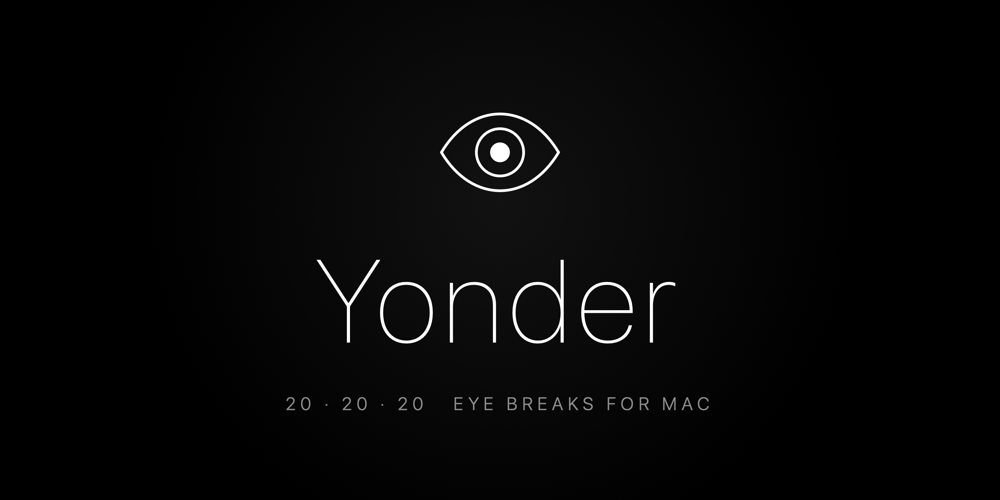
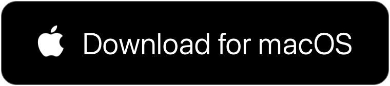
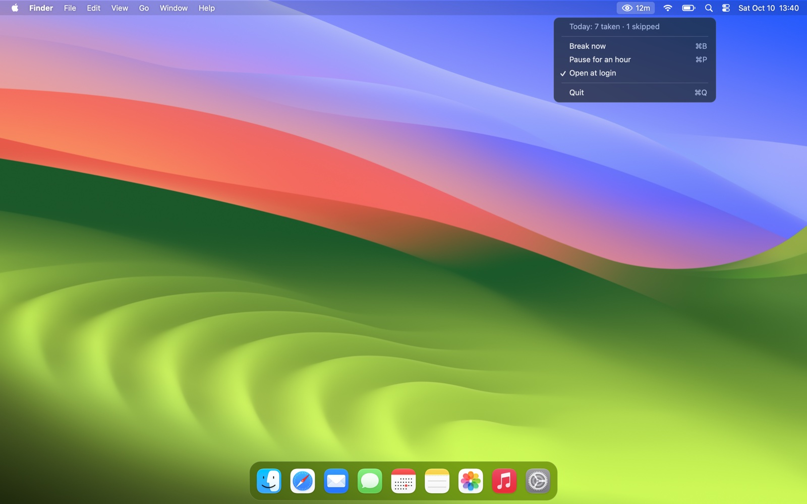
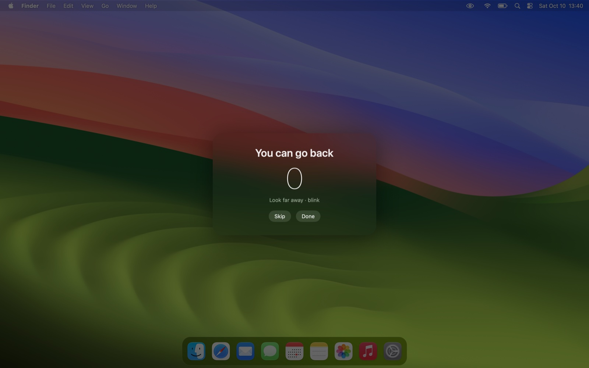
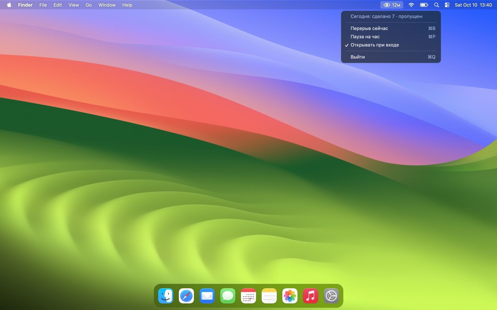

<p align="center">
  
</p>

<h1 align="center">Yonder — 20-20-20 eye break reminder for macOS</h1>

<p align="center">
  A free, open-source menu bar app that protects your eyes from digital eye strain.<br>
  Every 20 minutes it dims the screen and asks you to look 20 feet away for 20 seconds.
</p>

<p align="center">
  <a href="https://github.com/DanielGrash/yonder-eye-break/releases/latest/download/Yonder.dmg">
    
  </a>
</p>

<p align="center">
  <a href="https://github.com/DanielGrash/yonder-eye-break/releases/latest"></a>
  
  
  <a href="LICENSE"></a>
</p>


## What Yonder does

Hours at a screen tire the eyes: they dry out, focus gets harder, headaches come by evening. Eye doctors call it **digital eye strain** (computer vision syndrome). The simplest habit against it is the **20-20-20 rule**, and Yonder keeps it for you.

- **Counts real screen time only.** After 5 minutes away from the keyboard and mouse, your eyes count as rested and the timer starts over. Sleep and screen lock reset it too.
- **A soft break that doesn't block your work.** Every display dims and a 20-second countdown appears. Clicks still pass through, so calls, videos and games keep going.
- **Calm chimes** at the start and end of a break.
- **Minutes until the next break** in the menu bar, plus the day's breaks taken and skipped.
- **Break now**, **Pause for an hour** and **Open at login** in one click.
- **Private by design.** No account, no network requests, no analytics. The app is about 300 KB of native Swift.
- **English and Russian** interface, following your system language.





## Install

1. **[Download Yonder.dmg](https://github.com/DanielGrash/yonder-eye-break/releases/latest/download/Yonder.dmg)** and drag **Yonder** into **Applications**.
2. The first time, right-click Yonder and choose **Open**. The app is free and not notarized by Apple, so macOS asks once. Alternatively, run:
   ```sh
   xattr -dr com.apple.quarantine /Applications/Yonder.app
   ```
3. An eye appears in the menu bar. Turn on **Open at login** in its menu, and you're set.

A [.zip version](https://github.com/DanielGrash/yonder-eye-break/releases/latest/download/Yonder.zip) is available too.

## Compatibility

| | |
|---|---|
| **macOS** | 13 Ventura or later: Ventura, Sonoma, Sequoia, Tahoe, macOS 27 |
| **Processors** | Apple Silicon (M1–M5) and Intel, one universal app |
| **Tested on** | MacBook Pro with Apple M5 Pro, macOS 27.0, in daily use |
| **Displays** | Every connected display dims, across all Spaces and full-screen apps |
| **Not tested yet** | Intel Macs. If you run one, please open an issue with how it went. |

## Eye care basics

Yonder handles the first rule. The rest are the basics eye doctors repeat. They don't replace a visit to one.

1. **20-20-20.** Every 20 minutes, look about 20 feet (6 m) away for 20 seconds. Looking far away relaxes the eye's focusing muscle.
2. **Blink on purpose.** At a screen we blink far less often, and the eyes dry out. Take a few slow, full blinks during each break.
3. **Keep the screen at arm's length**, with its top edge at or slightly below eye level.
4. **Match screen brightness to the room**, and don't work in the dark.
5. **Every hour, stand up and look out of a window.**
6. **Burning, blurring or pain? See an eye doctor.**

## FAQ

### What is the 20-20-20 rule?
A simple habit against digital eye strain: every 20 minutes, look at something 20 feet away for 20 seconds. Yonder times it, dims the screen and counts the 20 seconds for you.

### Is Yonder free?
Yes. It's MIT-licensed open source, with no ads, subscription or in-app purchases.

### Will it interrupt my video call or game?
No. The dimming layer lets every click through, and the break panel never takes keyboard focus. You can skip a break with one click.

### Does Yonder collect any data?
No. It makes no network requests. It only stores the day's break counters, locally in macOS user defaults.

### Can I change the 20 minutes?
Yes, with environment variables, in seconds:

| Variable | Default | What it sets |
|---|---|---|
| `YONDER_INTERVAL` | `1200` | Screen time before a break |
| `YONDER_BREAK` | `30` | Length of the break |
| `YONDER_IDLE` | `300` | Time away that counts as rest |
| `YONDER_LANG` | system | `en` or `ru` |

```sh
YONDER_INTERVAL=1500 /Applications/Yonder.app/Contents/MacOS/Yonder
```

## Build from source

You need the Xcode Command Line Tools (`xcode-select --install`).

```sh
git clone https://github.com/DanielGrash/yonder-eye-break.git
cd yonder-eye-break
./build.sh    # runs the tests, then builds build/Yonder.app, .zip and .dmg
open build/Yonder.app
```

- `src/Scheduler.swift` holds the timer logic: active time, rest by idleness, sleep detection and pause. It is covered by `tests/main.swift`.
- `src/main.swift` holds the menu bar item, the dim windows and the break panel.
- `art/art.swift` draws the icon and banner, and `sounds/make.py` generates the chimes, so the repo has no third-party assets.

Issues and pull requests are welcome.

---

## По-русски

**Yonder** — бесплатное приложение для глаз на Mac. Каждые 20 минут работы оно мягко затемняет экран и просит 20 секунд посмотреть вдаль. Это правило **20-20-20** против усталости глаз от экрана.

- Считается только время, когда ты за компьютером. 5 минут без клавиатуры засчитываются как отдых.
- Перерыв не мешает: экран темнеет, но клики проходят насквозь, так что созвон или видео не прервутся.
- В строке меню видно, сколько минут осталось до перерыва и сколько перерывов сделано за день.
- Никаких аккаунтов, рекламы и слежки. Интерфейс на русском языке.




**[Скачать Yonder.dmg](https://github.com/DanielGrash/yonder-eye-break/releases/latest/download/Yonder.dmg)** и перетащить Yonder в «Программы». Первый раз открыть через правый клик → «Открыть». Работает на macOS 13 и новее, на Apple Silicon и Intel.

## License

[MIT](LICENSE) © Daniel Grash
